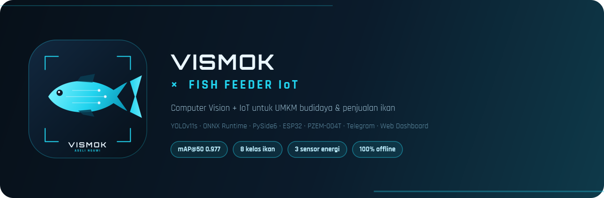
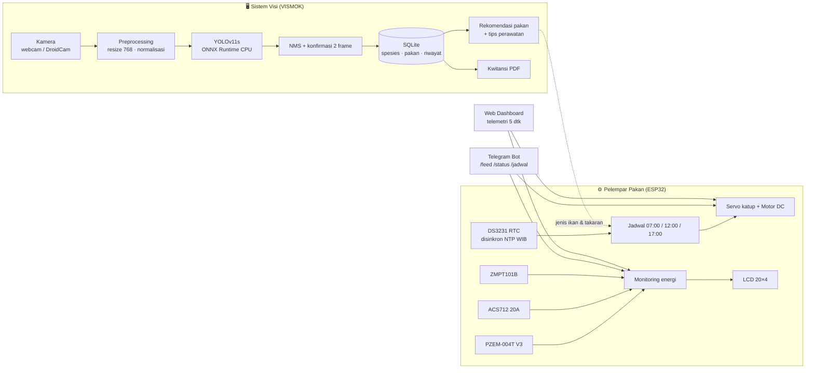
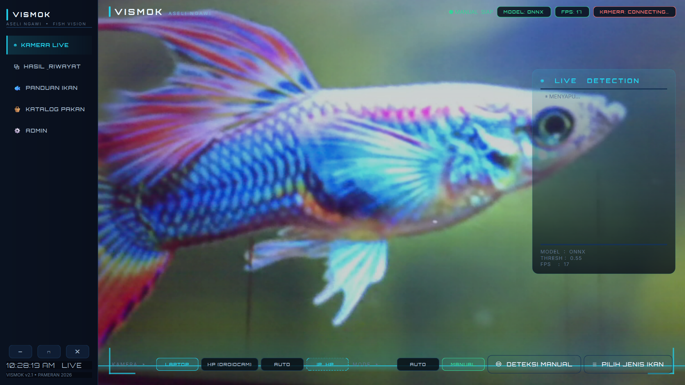
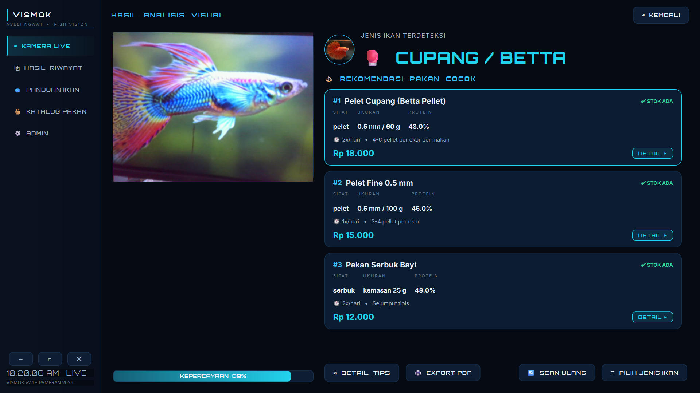
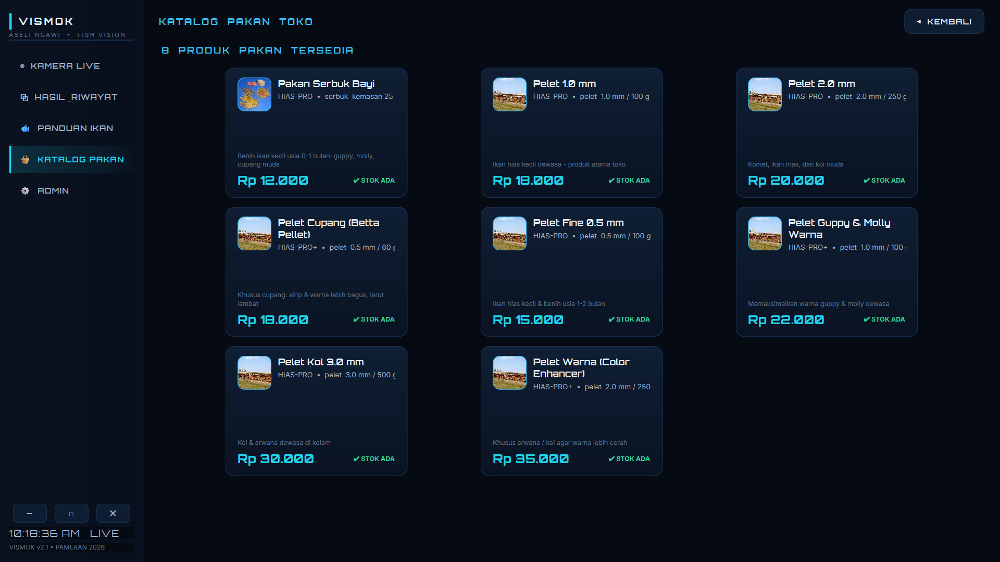
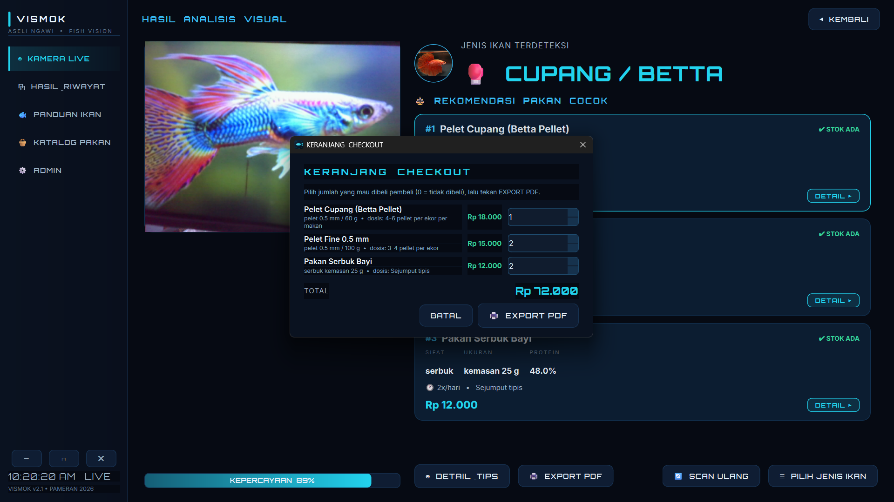
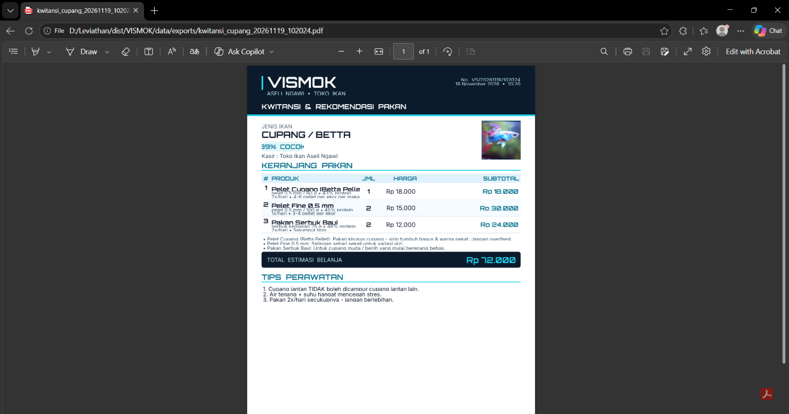
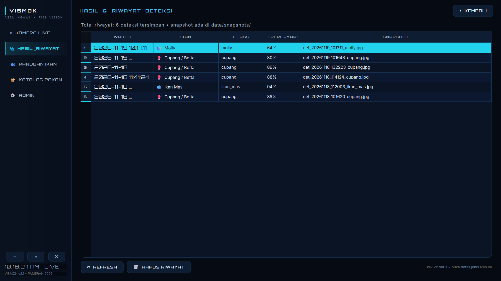
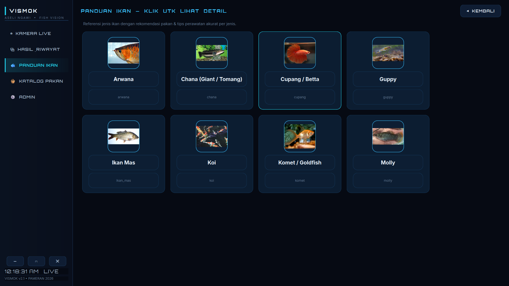
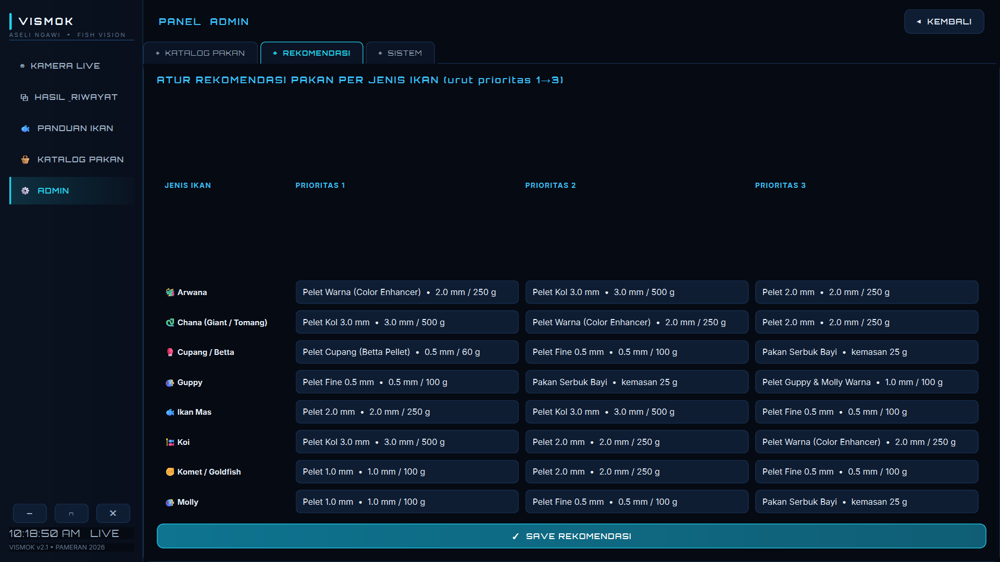

# VISMOK — Vision System for Fish Store

**Ekosistem budidaya & penjualan ikan berbasis Computer Vision + IoT** — dibangun untuk UMKM *Toko Ikan Aseli Ngawi*.

[](https://www.python.org/)
[-41CD52?logo=qt&logoColor=white)](https://doc.qt.io/qtforpython/)
[](https://docs.ultralytics.com/)
[](https://onnxruntime.ai/)
[](https://www.espressif.com/)
[](https://github.com/Forsaken1453/vismok-vision-system/releases/latest)
[](LICENSE)
[](#)

> **Dikembangkan oleh Muhammad Wildan Setyawan · 2026**
> Sistem yang **MELIHAT** ikan, **MENYARANKAN** pakan, **MEMBERI** pakan otomatis, **MEMANTAU** energi, dan **MELAPOR** ke Telegram & dashboard web — satu ekosistem tertutup.

---

## 📑 Daftar Isi

- [Latar Belakang](#-latar-belakang)
- [Arsitektur Sistem](#-arsitektur-sistem)
- [Fitur Utama](#-fitur-utama)
- [Tampilan Aplikasi](#-tampilan-aplikasi)
- [Hasil & Metrik](#-hasil--metrik)
- [Teknologi](#-teknologi)
- [Struktur Repo](#-struktur-repo)
- [Menjalankan Proyek](#-menjalankan-proyek)
- [Keputusan Teknis](#-keputusan-teknis)
- [Keamanan & Kredensial](#-keamanan--kredensial)
- [Tim & Lisensi](#-tim--lisensi)

---

## 🎯 Latar Belakang

Pemilik toko & pembudidaya ikan skala UMKM menghadapi tiga masalah berulang:

1. **Harus hadir fisik** untuk memantau ikan dan memberi pakan tepat waktu.
2. **Tidak tahu biaya energi** peralatan akuarium (aerator, pompa, heater) — listrik jadi biaya "tak terlihat".
3. **Rekomendasi pakan masih umum** — jenis ikan yang berbeda butuh pakan, takaran, dan frekuensi berbeda.

Proyek ini menjawab ketiganya dengan mendekatkan **computer vision** (mengenali jenis ikan dari kamera) dan **IoT** (pemberian pakan terjadwal, monitoring energi, kendali jarak jauh) dalam satu alur kerja.

---

## 🏗 Arsitektur Sistem



| Subsistem | Peran | Teknologi inti |
|---|---|---|
| **Visi (VISMOK)** | Mengenali jenis ikan + memberi rekomendasi pakan | YOLOv11s → ONNX, ONNX Runtime CPU, PySide6, SQLite |
| **Pelempar pakan** | Memberi pakan terjadwal & manual, aman | ESP32, DS3231 RTC, NTP, servo + motor DC (L298N) |
| **Monitoring energi** | Mengukur V/I/P/kWh dengan validasi silang | PZEM-004T V3 (utama), ACS712 20A, ZMPT101B |
| **Kanal kendali** | Kontrol & laporan jarak jauh | Telegram Bot + Web Dashboard (validasi perintah di sisi ESP32) |

---

## ✨ Fitur Utama

### 🖥 Sistem Visi — aplikasi desktop `VISMOK`
- Deteksi **8 jenis ikan** real-time: `guppy`, `koi`, `cupang`, `molly`, `komet`, `chana`, `arwana`, `ikan_mas`
- Model **YOLOv11s** di-*fine-tune* khusus, diekspor ke **ONNX** → berjalan di CPU tanpa PyTorch
- GUI futuristik **PySide6** (mode kiosk), kamera webcam & HP (**DroidCam** via "IP HP...")
- Rekomendasi pakan + tips perawatan per spesies (SQLite), riwayat deteksi, panel admin (PIN)
- **Kwitansi PDF** (QPdfWriter), snapshot ikan, indikator FPS & status model
- **100% offline** saat pameran/toko

### ⚙ Pelempar Pakan — firmware `feeder-iot`
- Jadwal otomatis **07:00 / 12:00 / 17:00** — jam dari **RTC DS3231** disinkron **NTP (WIB)** tiap 24 jam, tetap akurat walau internet mati
- **Kontrol Telegram**: `/menu`, `/feed [detik]`, `/status`, `/jadwal`, `/info`, `/help`
- **Keamanan berlapis**: whitelist chat ID → konfirmasi 2 langkah → cooldown 30 detik
- **Kontrol dashboard web**: perintah divalidasi ketat di sisi ESP32 (takaran 0,2–3,3; jadwal wajib 3 slot; jam 0–23)
- Monitoring energi **3 sensor** dengan validasi silang + LCD 20×4
- **Anti-dobel pakan** (flag per menit) dan pengukuran energi **saat motor masih berputar**

---

## 📸 Tampilan Aplikasi

| Kamera Live + Deteksi | Hasil Analisis & Rekomendasi Pakan |
|---|---|
|  |  |

<details>
<summary><b>Lihat tangkapan layar lainnya</b> (katalog, checkout, kwitansi, riwayat, dataset, admin)</summary>

| Katalog Stok Pakan | Keranjang & Checkout |
|---|---|
|  |  |

| Kwitansi PDF | Riwayat Deteksi |
|---|---|
|  |  |

| Data Ikan (Dataset 8 Kelas) | Panel Admin |
|---|---|
|  |  |

</details>

---

## 📊 Hasil & Metrik

Evaluasi pada **136 foto uji terpisah** (tidak ikut dilatih):

| Metrik | Nilai |
|---|---|
| **mAP@50** | **0,977** |
| mAP@50-95 | 0,951 |
| Recall | 0,926 |
| Presisi rata-rata | 0,926 |

| Kelas | mAP@50 | Recall |
|---|---|---|
| chana | 0,995 | 1,000 |
| komet | 0,995 | 1,000 |
| guppy | 0,995 | 1,000 |
| cupang | 0,995 | 0,932 |
| molly | 0,984 | 0,919 |
| arwana | 0,962 | 0,900 |
| koi | 0,951 | 0,750 |
| ikan_mas | 0,942 | 0,905 |

**Uji tambahan:** foto wajah manusia **tidak terdeteksi sebagai ikan** ✅ (uji negatif / false-positive).

> Catatan: koi dan ikan mas adalah pasangan paling sulit — keduanya karper (*Cyprinus*), pembeda utamanya pola warna. Keterbatasan ini dievaluasi terbuka, bukan disembunyikan.

---

## 🧰 Teknologi

| Lapisan | Komponen |
|---|---|
| **Vision** | YOLOv11s (Ultralytics), PyTorch (training), ONNX Runtime (inference CPU), NumPy (preprocess/NMS manual) |
| **Desktop app** | Python 3.11, PySide6 (Qt 6), SQLite, QPdfWriter, PyInstaller (onedir) |
| **Kamera** | OpenCV (DSHOW webcam), HTTP stream DroidCam (FFmpeg) |
| **Dataset** | Wikimedia Commons (bebas lisensi), auto-label YOLO-World, split 90/10 |
| **Firmware** | Arduino C++ (ESP32 Dev Module), RTClib, LiquidCrystal_I2C, PZEM004Tv30, ESP32Servo, UniversalTelegramBot, ArduinoJson |
| **Dashboard** | Python web server (`feeder-iot/app`), REST API `POST /api/ingest` |
| **Perangkat** | ESP32, DS3231, PZEM-004T V3, ACS712 20A, ZMPT101B, SG90, L298N, LCD 20×4 I2C |

---

## 📁 Struktur Repo

```
vismok/
├─ vision-app/                 Aplikasi desktop VISMOK
│  ├─ app/                     core detector, database, UI (PySide6)
│  ├─ models/                  model.onnx (YOLOv11s) + classes.json
│  ├─ tools/                   collect_dataset · autolabel_dataset · train_leviathan
│  ├─ tests/                   evaluasi model & uji kamera
│  ├─ docs/                    MODEL_CARD · DATASET_GUIDE · TRAINING_QUICKSTART
│  ├─ run.py                   entry point
│  └─ build_exe.cmd            build PyInstaller (onedir) → dist/VISMOK/VISMOK.exe
│
├─ feeder-iot/                 Firmware ESP32 + dashboard
│  ├─ firmware/                .ino utama + dokumen penjelasan kode
│  ├─ app/                     server dashboard (REST API, storage, alerts)
│  ├─ docs/                    wiring, panduan
│  └─ poster/                  poster produk
│
└─ docs/
   └─ assets/banner.png
```

---

## 🚀 Menjalankan Proyek

### A. Aplikasi visi (VISMOK)

**Cara tercepat — unduh paket portable** dari [Releases](https://github.com/Forsaken1453/vismok-vision-system/releases/latest)
(`VISMOK-v1.0.0-win64.zip`), ekstrak, lalu jalankan `VISMOK.exe`. Tidak perlu Python.

Dari sumber:

```bash
cd vision-app
pip install -r requirements.txt
python run.py
```

Build exe stand-alone:

```bat
cd vision-app
build_exe.cmd
:: hasil: dist\VISMOK\VISMOK.exe (+ model & assets)
```

### B. Firmware ESP32 + dashboard

1. Jalankan dashboard: `cd feeder-iot` → `run.bat` (server API).
2. Buka `feeder-iot/firmware/Kode_Final_Vismok_Dashboard/Kode_Final_Vismok_Dashboard.ino`
   di **Arduino IDE** (Board: *ESP32 Dev Module*).
3. Isi kredensial di bagian atas sketch (placeholder `ISI_...`).
4. Sesuaikan `DASHBOARD_URL` dengan IP server dashboard.
5. Upload, lalu kalibrasi `ACS712_SENSITIVITY` & `zmpt_calibration` memakai multimeter.

Daftar library & catatan wiring ada di [`feeder-iot/README.md`](feeder-iot/README.md) dan [`feeder-iot/docs`](feeder-iot/docs).

---

## 🧠 Keputusan Teknis

Pemilihan model dilakukan lewat pengujian, bukan asumsi:

| Metode diuji | Hasil | Keputusan |
|---|---|---|
| YOLO-World open-vocabulary sebagai verifikasi spesies | 4/48 cocok | ❌ ditolak |
| CLIP zero-shot klasifikasi | 62%, probabilitas mendatar ≈0,13 | ❌ ditolak |
| **Fine-tuning YOLOv11s + auto-label** | **mAP@50 0,977** | ✅ dipakai |

**Logika kontrol feeder:** *time-triggered open-loop* dengan *rule-based interlocks* (bukan fuzzy).
Dipilih karena jadwal pakan UMKM bersifat baku; sistem sederhana lebih andal, mudah diaudit,
dan tidak menambah kompleksitas tanpa data umpan balik yang terukur. Kecerdasan sistem berada
di lapisan visi (deep learning) dan integrasi data.

Detail lengkap: [`vision-app/docs/MODEL_CARD.md`](vision-app/docs/MODEL_CARD.md).

---

## 🔐 Keamanan & Kredensial

Seluruh kredensial di repo ini **placeholder**:

| Placeholder | Isi dengan |
|---|---|
| `ISI_SSID_WIFI` / `ISI_PASSWORD_WIFI` | WiFi 2,4 GHz (ESP32 tidak mendukung 5 GHz) |
| `ISI_BOT_TOKEN_DARI_BOTFATHER` | Token bot dari @BotFather |
| `ISI_CHAT_ID_GRUP` | ID chat/grup yang diizinkan mengendalikan alat |

Lapisan keamanan yang sudah diterapkan:

- **Whitelist chat ID** — bot menolak chat tak terdaftar (dan menampilkan ID-nya untuk pendaftaran).
- **Konfirmasi dua langkah** sebelum motor/servo bergerak (kedaluwarsa 60 detik).
- **Cooldown 30 detik** antar pakan manual (anti-overfeeding).
- **Validasi perintah dashboard di sisi ESP32** — server tidak dapat memerintah di luar batas.

---

## 👤 Pengembang & Lisensi

**Muhammad Wildan Setyawan**
2026

Dirilis di bawah lisensi [MIT](LICENSE) — bebas digunakan dengan atribusi.
